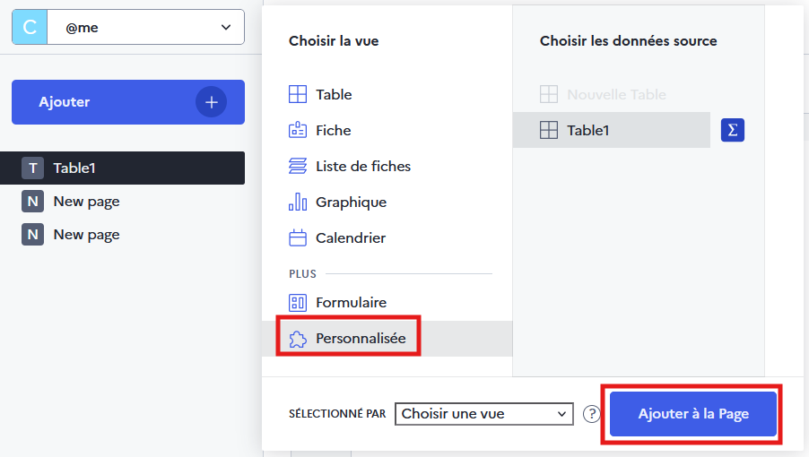
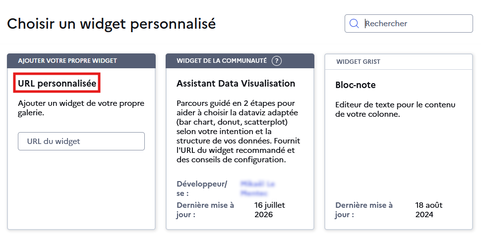
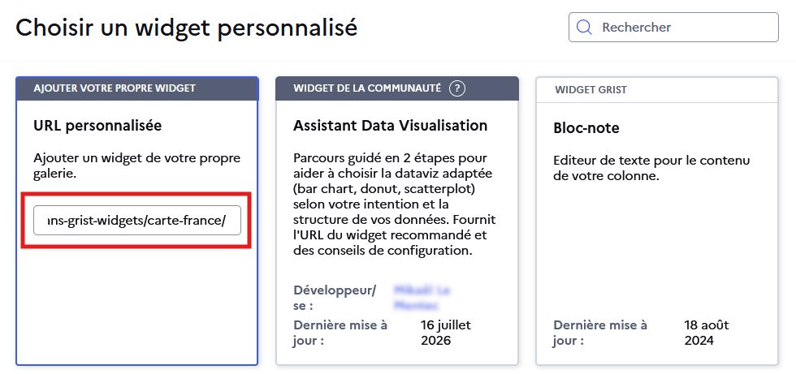

# ans-grist-widgets

## Widgets sans backend

### Carte de France

Ce widget est un fork de [carte-france](https://github.com/Bigorneau15652/map/tree/master/carte-france) proposé par [Bigorneau15652](https://github.com/Bigorneau15652).
Il a en particulier été enrichi des besoins relatifs aux produits du domaine Urgences.

* Option pour afficher les numéros de départements sur la carte
* Gestion des entités 64A/64B et 76A/76B
* Gestion des catégories représentées par des emojis

## Ajouter un widget personnalisé dans une vue Grist

1) Ajouter une vue personnalisée à la page

3) Choisir le widget URL personnalisée

4) Renseigner l'URL du widget personnalisé

